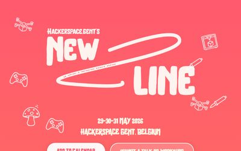
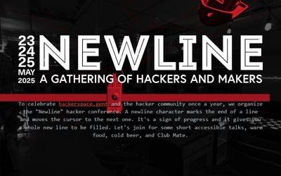

# Newline

Newline is the yearly conference organised by Hackerspace.gent.

## Websites

Each edition gets its own website, hosted on GitHub Pages. Click a screenshot to open the site.

### Newline 2026

[{ width="400" }](https://0x20.github.io/newline2026/)

[https://0x20.github.io/newline2026/](https://0x20.github.io/newline2026/)

### Newline 2025

[{ width="400" }](https://0x20.github.io/newline2025/)

[https://0x20.github.io/newline2025/](https://0x20.github.io/newline2025/)

## Credits

The websites were made by [Mateo Van Damme](https://github.com/MateoVanDamme). The source for each site lives in the [0x20 GitHub organisation](https://github.com/0x20).
